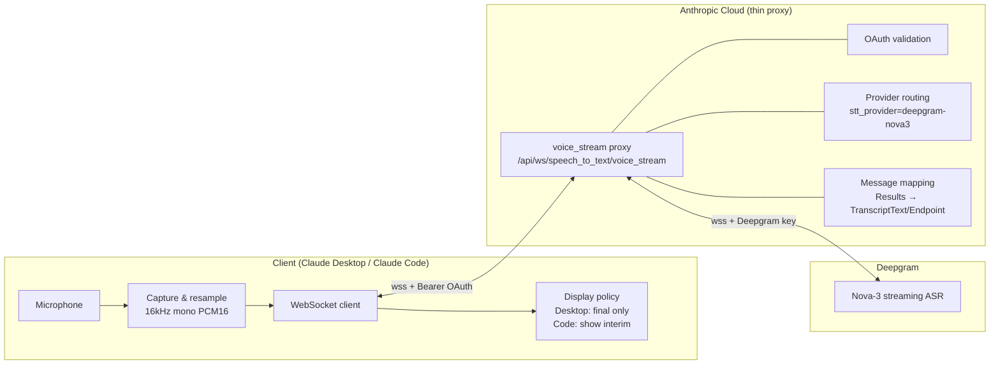
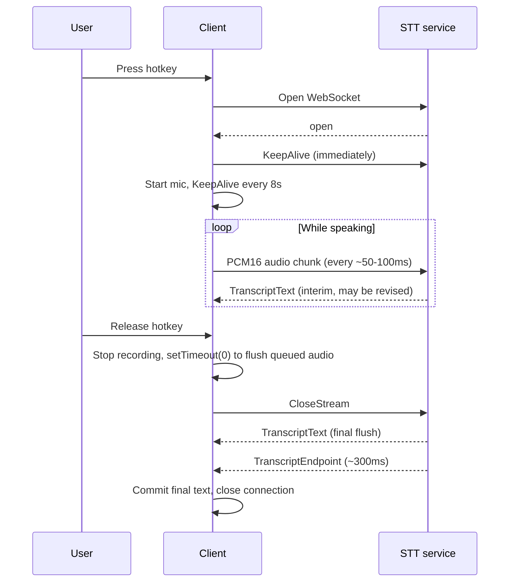
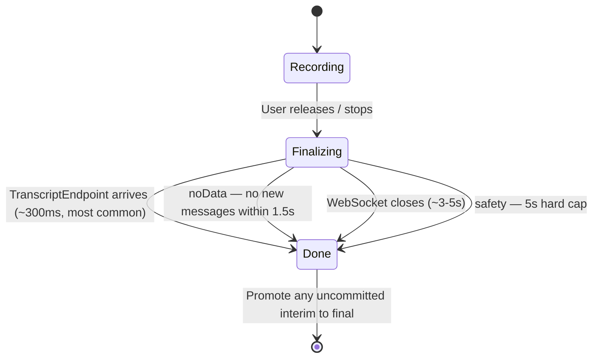
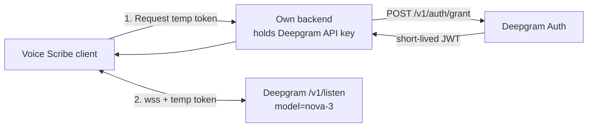

# How Claude's Voice Dictation Works & Voice Scribe Replication Guide

> Purpose: Explain how Claude's speech-to-text (Desktop / Claude Code) is implemented, and provide a complete spec for replicating the same experience in Voice Scribe using Deepgram Nova-3.
> For Claude Code: Sections 4–8 are the implementation spec and can be used directly as the task description.
>
> **Execution order for Claude Code**: Read the existing Voice Scribe code to confirm the tech stack and current STT implementation → implement with `@deepgram/sdk` per Section 6.8 (verify method names against the SDK type definitions) → implement audio capture, transcript state, finalize, and display modes per 6.1–6.5 → abstract an `SttProvider` interface (Section 7) → verify against Section 8.

**Source note**: Sections 1–3 are based on the publicly circulated Claude Code source `services/voiceStreamSTT.ts` (unofficial) and the endpoint observed in network traffic. This is reverse-engineered and Anthropic may change it at any time. `claude.ai/api/ws/...` is a private API — **do not call it from Voice Scribe**; connect to Deepgram directly.

---

## 1. Overall Architecture



Responsibilities by layer:

| Layer | Responsible for | When replicating |
|---|---|---|
| Deepgram API | Streaming recognition, interim/final results, endpointing, keyterms, KeepAlive/CloseStream protocol | **Use directly** |
| Anthropic proxy | Auth/key exchange, model routing, message simplification, billing & rate limiting | Replace with a small backend of your own (only to mint temporary tokens) |
| Client | Audio capture, streaming, finalize timeout logic, display policy | **Implement per Sections 5–6** |

---

## 2. Claude's Connection Parameters (actual values from source)

Connection URL:

```
wss://<base>/api/ws/speech_to_text/voice_stream?encoding=linear16&sample_rate=16000&channels=1
  &endpointing_ms=300&utterance_end_ms=1000&language=en
  [&use_conversation_engine=true&stt_provider=deepgram-nova3]   ← feature flag tengu_cobalt_frost
  [&keyterms=xxx&keyterms=yyy ...]                              ← up to ~50
```

Headers: `Authorization: Bearer <claude.ai OAuth token>`, `User-Agent`, `x-app: cli`

| Parameter | Value | Purpose |
|---|---|---|
| encoding | linear16 | Raw 16-bit PCM, no container, no compression |
| sample_rate | 16000 | 16kHz, standard ASR sample rate |
| channels | 1 | Mono |
| endpointing_ms | 300 | 300ms of silence marks the end of a phrase |
| utterance_end_ms | 1000 | 1s without new words marks the end of an utterance |
| language | en (default) | Language |
| keyterms | Project-specific terms | Keyword boosting for proper nouns |

Other constants:
- KeepAlive interval: **8 seconds**; send one **immediately** when the socket opens (mic init can take >1s; prevents the server from closing early)
- Finalize timeouts: `noData = 1500ms`, `safety = 5000ms`

Host selection: Claude Code connects to `api.anthropic.com` (Cloudflare on claude.ai blocks non-browser clients via TLS fingerprinting); **the Desktop app uses Swift URLSession to connect to `claude.ai`** (browser-like fingerprint, allowed through).

---

## 3. Protocol & Messages

### 3.1 Client → Server

| Frame | Content |
|---|---|
| Binary frame | PCM16 audio chunk |
| `{"type":"KeepAlive"}` | Keep connection alive (native Deepgram message) |
| `{"type":"CloseStream"}` | Stop accepting audio and flush remaining results (native Deepgram message) |

### 3.2 Server → Client (simplified format from Anthropic's proxy)

| Message | Meaning |
|---|---|
| `{"type":"TranscriptText","data":"..."}` | Current transcript text (may be interim and revised later) |
| `{"type":"TranscriptEndpoint"}` | End of phrase; the last TranscriptText is final |
| `{"type":"TranscriptError", ...}` | Recognition error |

### 3.3 Full Sequence (push-to-talk → release)



---

## 4. Key Implementation Details (what makes it fast and accurate)

### 4.1 Why the text appears all at once after you stop
- Audio streams continuously while you speak and the server recognizes continuously, **so by release time almost all the work is done** — only the last few hundred milliseconds remain.
- Source comment: **Nova-3 only emits an endpoint on the final flush**; everything received while speaking is interim and may be revised.
- The Desktop UI chooses **not to display interim results**, only the final one → visually, "everything appears after I stop." Claude Code shows interim results as a live preview.

### 4.2 Interim handling (Nova-3 specifics)
- Nova-3 interims are **cumulative across segments** and can **revise earlier words** (e.g. `"Hello?"` → `"Hello."`).
- The legacy Deepgram path used a "prefix check" to detect new segments and auto-finalize the previous one; **this auto-finalize must be disabled for Nova-3**, otherwise text gets duplicated.
- Rule: with Nova-3, always overwrite the display with the latest interim; commit only on endpoint / stream end.

### 4.3 Four ways finalize resolves (whichever comes first)



Key points:
1. Before sending CloseStream, use `setTimeout(0)` (or equivalent) so **already-queued audio callbacks are sent first**; otherwise the tail of the speech is lost.
2. After CloseStream, **drop any further audio chunks** (the server rejects them and raises a protocol error).
3. Any TranscriptText received after CloseStream → cancel the noData timer (data is slow, not absent).
4. Under every resolution path, if an uncommitted interim remains, **promote it to final** so no words are lost.
5. Errors that occur during finalizing must **not clear the accumulated text**.

### 4.4 Error handling
- HTTP upgrade rejected (non-101): treat 4xx as fatal (invalid token; retrying won't help); 5xx is retryable.
- Some ws implementations on Windows fire unexpected-response even for 101 — ignore 101.
- Close codes 1000 / 1005 are normal closes; do not report an error.

---

## 5. Voice Scribe Replication Plan (direct to Deepgram)

### 5.1 Architecture



- If Voice Scribe is a local / personal-use app, the key can live in the local keychain (macOS Keychain) and the backend can be skipped.
- If there is a distributed client (Web/iOS), **the key must never ship in the client**; exchange it for a short-lived token via `/v1/auth/grant`.

### 5.2 Connection URL (Deepgram-native equivalent of Claude's parameters)

```
wss://api.deepgram.com/v1/listen
  ?model=nova-3
  &language=multi            # Chinese/English code-switching; for pure Chinese try zh — benchmark both
  &language_hint=zh
  &language_hint=en
  &encoding=linear16
  &sample_rate=16000
  &channels=1
  &interim_results=true      # required; utterance_end_ms depends on it
  &endpointing=300           # = Claude's endpointing_ms
  &utterance_end_ms=1000     # = Claude's utterance_end_ms
  &smart_format=true         # punctuation, numbers, dates formatting
  &keyterm=Brewer&keyterm=homelab ...   # = Claude's keyterms (Nova-3 uses keyterm)
```

Header: `Authorization: Token <API_KEY>` (or temporary token: `Authorization: Bearer <JWT>`)

Parameter mapping:

| Claude proxy parameter | Deepgram native parameter |
|---|---|
| `endpointing_ms` | `endpointing` |
| `utterance_end_ms` | `utterance_end_ms` |
| `keyterms` | `keyterm` (Nova-3) |
| `stt_provider=deepgram-nova3` | `model=nova-3` |
| (implicit) | `interim_results=true` |

### 5.3 Deepgram native response messages (replace TranscriptText / TranscriptEndpoint)

| type | Key fields | Handling |
|---|---|---|
| `Results` | `channel.alternatives[0].transcript`, `is_final`, `speech_final` | `is_final=false` → interim (overwrite preview); `is_final=true` → append to committed text |
| `UtteranceEnd` | `last_word_end` | End of utterance; can be treated as an endpoint |
| `SpeechStarted` | — | Optional UI signal (requires `vad_events=true`) |
| `Metadata` | `request_id` | Returned on close; log it |

> Note: when connecting to Deepgram directly, `is_final=true` results are **segmented, not cumulative** (each contains only the newly finalized portion), so the client must concatenate them. This differs from the "cumulative interim" format simplified by Anthropic's proxy. Rule: `committed += final.transcript`, `display = committed + currentInterim`.

### 5.4 Client → Deepgram control messages

| Message | Use |
|---|---|
| `{"type":"KeepAlive"}` | Every 8s; once immediately after connecting |
| `{"type":"Finalize"}` | Flush buffered audio to final immediately, **connection stays open** (for "continuous dictation, commit per segment" mode) |
| `{"type":"CloseStream"}` | Flush and close (for "push-to-talk" mode, matches Claude's behavior) |

---

## 6. Voice Scribe Implementation Spec (task checklist for Claude Code)

### 6.1 Audio capture
- [ ] Capture microphone → resample to **16kHz, mono, PCM16 little-endian**
  - macOS/iOS: `AVAudioEngine` + `AVAudioConverter` (input is usually 48kHz Float32)
  - Node/Electron: native recording module, or Web Audio `AudioWorklet` downsampling
  - Browser: `AudioWorklet` converting to Int16
- [ ] Send one chunk every **20–100ms** (16kHz × 2 bytes × 0.05s ≈ 1600 bytes/chunk)
- [ ] **Copy the buffer** before sending (native module buffers may share a memory pool)

### 6.2 Connection management
- [ ] Send `KeepAlive` immediately after open, then every 8s
- [ ] Start sending audio only after `open` (`onReady` callback)
- [ ] Handle 4xx (fatal, prompt user to check key) / 5xx (retryable)

### 6.3 Transcript state

```ts
type TranscriptState = {
  committed: string;   // accumulated is_final=true results
  interim: string;     // latest interim, overwritten by the next one
};
// display = committed + interim
```

- [ ] `Results` with `is_final=false` → `interim = transcript`
- [ ] `Results` with `is_final=true` → `committed += (committed ? ' ' : '') + transcript; interim = ''`
  - Chinese needs no space: choose the joiner by language, or rely on `smart_format` output
- [ ] On finish, if `interim` is non-empty → promote it into `committed`

### 6.4 Stop / finalize
- [ ] Stop recording → send `CloseStream` on the next event-loop tick (ensures tail audio has been sent)
- [ ] After `finalized=true`, drop new audio chunks
- [ ] Resolve on whichever comes first: final `Results(is_final)` after CloseStream + connection close / noData 1.5s / safety 5s
- [ ] Errors during finalizing must not clear the text

### 6.5 Display modes (configurable)

| Mode | Behavior | Equivalent |
|---|---|---|
| `final-only` | No text while speaking (show waveform/timer), fill everything in after stop | Claude Desktop |
| `live` | `committed` in normal color + `interim` in muted color, live | Claude Code `/voice` |

Default to `live`, switchable in settings.

### 6.6 Accuracy
- [ ] Support a user-defined keyterm list (project names, people, technical terms), up to ~50
- [ ] Setting: language mode `multi` / `zh` / `en`
- [ ] Benchmark `multi` vs `zh` on the same Chinese/English mixed recording and pick the default

### 6.7 Reference skeleton (TypeScript / Node, raw WebSocket)

```ts
import WebSocket from 'ws';

const params = new URLSearchParams({
  model: 'nova-3', language: 'multi',
  encoding: 'linear16', sample_rate: '16000', channels: '1',
  interim_results: 'true', endpointing: '300', utterance_end_ms: '1000',
  smart_format: 'true',
});
['zh', 'en'].forEach(h => params.append('language_hint', h));
keyterms.forEach(k => params.append('keyterm', k));

const ws = new WebSocket(`wss://api.deepgram.com/v1/listen?${params}`, {
  headers: { Authorization: `Token ${process.env.DEEPGRAM_API_KEY}` },
});

let committed = '', interim = '', finalized = false;
let keepalive: NodeJS.Timeout;

ws.on('open', () => {
  ws.send(JSON.stringify({ type: 'KeepAlive' }));
  keepalive = setInterval(() => ws.send(JSON.stringify({ type: 'KeepAlive' })), 8000);
  startMic(chunk => {                       // chunk: Buffer, PCM16 16k mono
    if (!finalized && ws.readyState === WebSocket.OPEN) ws.send(Buffer.from(chunk));
  });
});

ws.on('message', raw => {
  const msg = JSON.parse(raw.toString());
  if (msg.type !== 'Results') return;
  const text = msg.channel?.alternatives?.[0]?.transcript ?? '';
  if (!text) return;
  if (msg.is_final) { committed += text; interim = ''; }
  else interim = text;
  render(committed, interim);              // render according to display mode
});

export function stop(): Promise<string> {
  stopMic();
  return new Promise(resolve => {
    const done = () => { clearInterval(keepalive); committed += interim; interim = ''; resolve(committed); };
    const safety = setTimeout(done, 5000);
    ws.once('close', () => { clearTimeout(safety); done(); });
    setTimeout(() => {                      // let queued audio flush first
      finalized = true;
      ws.send(JSON.stringify({ type: 'CloseStream' }));
    }, 0);
  });
}
```

(Fill in the noData 1.5s timer, error classification, reconnection, etc. per 6.2–6.4.)

### 6.8 Prefer the official SDK `@deepgram/sdk` (new DeepgramClient API)

Deepgram's official examples use the new SDK; prefer the SDK over a hand-written WebSocket. Core API from the official example (transcribing an AAC radio stream):

```ts
import { DeepgramClient } from '@deepgram/sdk';

const deepgram = new DeepgramClient({ apiKey: process.env.DEEPGRAM_API_KEY });
const socket = await deepgram.listen.v1.createConnection({ model: 'nova-3', language: 'en' });

socket.on('message', (data) => {
  if (data.type === 'Results' && data.channel?.alternatives?.[0]) {
    const transcript = data.channel.alternatives[0].transcript;
    if (transcript) console.log(transcript);
  }
});
socket.on('close', () => console.log('Connection closed.'));
socket.on('error', (err) => console.error(err));

socket.connect();
await socket.waitForOpen();          // must wait for open before sending audio
socket.sendMedia(chunk);             // send an audio chunk
```

**Differences between the official example and Voice Scribe (must change):**

| Official example | Voice Scribe must |
|---|---|
| Streams an AAC container; Deepgram auto-detects the encoding, so no encoding is passed | Streams raw mic PCM; **must** pass `encoding: 'linear16'`, `sample_rate: 16000`, `channels: 1`, otherwise results are empty or garbage |
| Only `model` and `language: 'en'` | Add all parameters from 5.2: `language: 'multi'`, `language_hint`, `interim_results`, `endpointing: 300`, `utterance_end_ms: 1000`, `smart_format`, `keyterm` |
| Doesn't distinguish `is_final`, just prints | Distinguish interim / final and concatenate per 6.3 |
| No KeepAlive | Once immediately after connect + every 8s |
| Stream never ends | Push-to-talk: release → send CloseStream on next tick → wait for final result (6.4) |
| API key hardcoded in source | **Never hardcode**; read from environment variable / macOS Keychain; distributed clients use `/v1/auth/grant` temporary tokens |

**Target SDK implementation:**

```ts
const socket = await deepgram.listen.v1.createConnection({
  model: 'nova-3',
  language: 'multi',
  language_hint: ['zh', 'en'],
  encoding: 'linear16',
  sample_rate: 16000,
  channels: 1,
  interim_results: true,
  endpointing: 300,
  utterance_end_ms: 1000,
  smart_format: true,
  keyterm: userKeyterms,
});

let committed = '', interim = '';
socket.on('message', (data) => {
  if (data.type !== 'Results') return;
  const t = data.channel?.alternatives?.[0]?.transcript;
  if (!t) return;
  if (data.is_final) { committed += t; interim = ''; }
  else interim = t;
  render(committed, interim);
});

socket.connect();
await socket.waitForOpen();
// mic PCM16 16k mono chunks → socket.sendMedia(Buffer.from(chunk))
```

**Verify against the SDK type definitions (`.d.ts` in `node_modules/@deepgram/sdk`) during implementation:**
- [ ] Method names for control messages: whether KeepAlive / Finalize / CloseStream have dedicated methods (e.g. `sendKeepAlive()`, `sendFinalize()`, `sendCloseStream()`), or must be sent as JSON (`{"type":"KeepAlive"}` etc.) through a generic send method
- [ ] Parameter types: whether `language_hint` and `keyterm` accept arrays; whether boolean/number parameters must be passed as strings
- [ ] Whether a temporary token (Bearer) can be passed instead of an apiKey
- [ ] Whether reconnection is handled by the SDK or must be implemented manually
- If the SDK cannot meet any of the above, fall back to the raw WebSocket implementation in 6.7 (identical protocol)

---

## 7. Alternative: xAI Grok STT

The same client logic can swap backends for A/B comparison:

| | Deepgram Nova-3 | xAI Grok STT |
|---|---|---|
| Streaming endpoint | `wss://api.deepgram.com/v1/listen` | `wss://api.x.ai/v1/stt` |
| Model | `nova-3` | `grok-stt` |
| Streaming price | ~$0.46/hour | $0.20/hour |
| Chinese | Officially supports Mandarin (Simplified/Traditional), Cantonese, and `multi` code-switching | 25 languages; Chinese quality must be tested |

Recommendation: abstract an `SttProvider` interface in Voice Scribe (connect / sendAudio / finalize / onTranscript). Implement Deepgram first, xAI as a second implementation, and compare on the same set of recordings.

---

## 8. Acceptance Criteria

- [ ] Full text appears **< 500ms** after releasing the hotkey (normal network)
- [ ] No lost tail audio (last word complete)
- [ ] Chinese/English mixed sentences (e.g. "把 Brewer 的 pipeline 部署到 homelab") are recognized correctly
- [ ] Proper nouns in the keyterm list are recognized correctly
- [ ] Clear error message when offline; no hang
- [ ] Both `final-only` and `live` modes work
- [ ] API key never appears in any distributable client code or in Git history (if it was ever committed, rotate it immediately in the Deepgram Console)

## References
- Claude Code source dump `services/voiceStreamSTT.ts`: https://tangled.org/oppi.li/claude-code/raw/main/services/voiceStreamSTT.ts
- Deepgram Streaming API: https://developers.deepgram.com/docs/live-streaming-audio
- Deepgram Nova-3 language prompting: https://developers.deepgram.com/docs/nova-3-language-prompting
- xAI Grok STT announcement: https://x.ai/news/grok-stt-and-tts-apis
